# User guide

TooDoo is a small to-do list for the browser and for Android phones. This guide shows how to use
it: items, their order, due dates, reminders and labels. Open the app at https://toodoo.fly.dev.

## Get started

### Create an account

1. Open https://toodoo.fly.dev and click **Sign up**.
2. Type a username: 3 to 32 letters, digits, `-` or `_`.
3. Type a password. The page shows the shortest length that it accepts.
4. Click **Create account**. Your list opens.

There is no email address. If you forget your password, ask the admin of the app.

### Log in and log out

1. Type your username and password. **Show** next to the password shows what you typed.
2. If you use your own computer, select **Keep me logged in**. Then you stay logged in for 30
   days. You can be logged in on at most 20 devices or browsers at the same time. A new login
   ends the oldest one.
3. Click **Log in**.

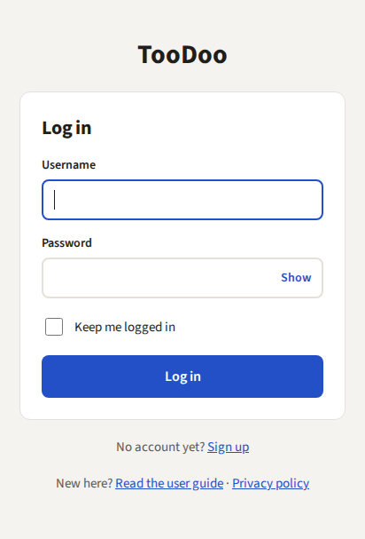

To log out, click **Log out** at the top right of your list. On a phone, **Log out** is on the
**Account** page.

The top right of your list also has the links **Labels** (see "The Labels page"), **Help** (this
guide) and **Account**.

### Your account

Click **Account** at the top right of your list. On the Account page you can:

- Change your password. You must type your current password first. After the change, the app
  logs you out on your other devices. After 5 wrong current passwords, wait 15 minutes before
  you try again.
- Delete your account. Type your username to confirm. This deletes your username, your
  password, all your items and labels, and all your logins at once. You cannot undo it. The
  daily backups of the server keep this data for up to 5 more days. After that, it is gone.

If you use only the Android app, delete your toodoo account on the web: log in at
https://toodoo.fly.dev, click **Account**, and type your username to confirm. The Android app
has no delete button.

The privacy policy at https://toodoo.fly.dev/privacy tells you which data the app stores, why,
and for how long. The login, sign-up and Account pages link to it.

## Items

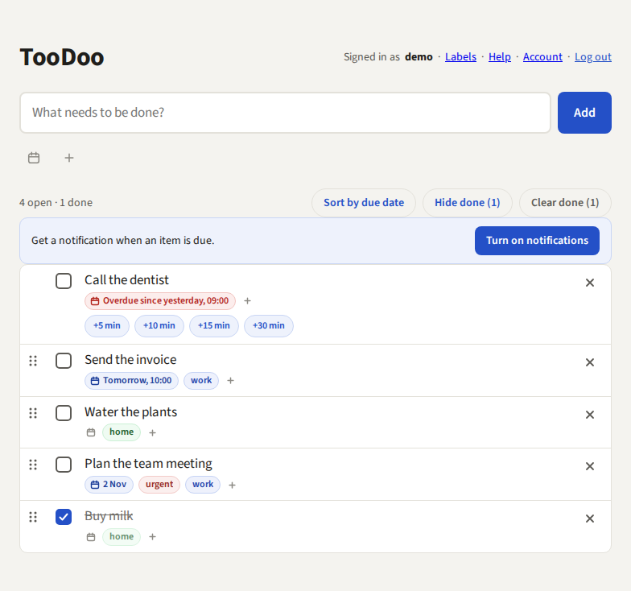

### Add an item

1. Type the task in the field "What needs to be done?".
2. If you want a due date, click the calendar icon under the field. Pick the day and, if you
   want, the time, then click **Save**. In place of the icon, a button shows the date. To remove
   the date, point at that button and click the × that shows in it.
3. If you want labels, click the **+** under the field. Click a label name to select it, or type
   a new name to create a label. The selected labels show before the +, each with an ×.
4. Press Enter or click **Add**. The item goes to the end of the list, also if its due date has
   already passed. If the list is sorted by due date, the item goes to its place in that order.
   The date and the labels under the field then clear.

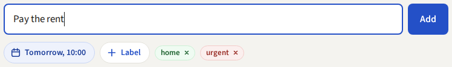

An item text has at most 500 characters. You can have at most 5,000 items, done or not.

If nothing on the page has the focus, you can start to type at once. The text goes into the
add field.

### Edit an item

1. Click the text of the item. The text becomes a field.
2. Change the text.
3. Press Enter to save, or Esc to cancel. If you click somewhere else, the app saves the text.

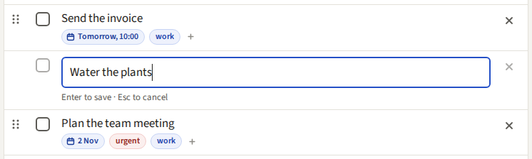

### Notes on an item

An item can have notes: a longer text, for example an address, a phone number or a link.

1. Click the notes icon (three short lines) next to the calendar icon of the item. A pop-up
   with a field opens.
2. Type the notes. Enter makes a new line.
3. Click **Save**, or press Ctrl+Enter (⌘+Enter on a Mac). Esc closes the pop-up without
   saving.

An item with notes shows a gray **notes** chip in place of the icon. Click it to read the
notes. A link that starts with http:// or https:// opens in a new tab. To change the notes,
click **Edit**.

To remove the notes, point at the **notes** chip and click the × that shows in it. "Notes
removed." with **Undo** shows at the end of the row. To get the notes back, click **Undo** or
press Ctrl+Z. After 8 seconds, **Undo** goes away.

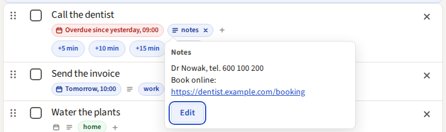

The notes have at most 2,000 characters. The app keeps the line breaks, but no other
formatting (for example, no bold text). The notes stay with the item when you change its
text, its date or its labels, and when a repeating item moves to its next date.

### Check off and delete

- Click the box on the left of an item to mark it done. Click it again to mark it not done.
- Click the × on the right of an item to delete it. A gray line with **Undo** shows in its
  place. To get the item back, click **Undo** or press Ctrl+Z. The app deletes the item after 8
  seconds, or before your next change.

### Done items

Above the list, the app shows how many items are open and how many are done, for example
"4 open · 1 done". Before your first item, the counter and the buttons do not show.

- **Hide done** hides the done items. **Show done** shows them again. The app remembers your
  choice.
- **Clear done** deletes all done items. The app asks first, because you cannot undo it. If the
  number of done items changes before you click **Delete** (for example in another tab), the
  app deletes nothing and asks again with the new number. If the list shows only the items of
  one label, **Clear done** deletes only the done items with that label.

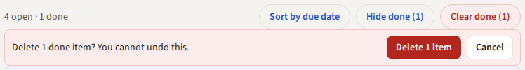

### Search the items

1. Click the magnifying glass (⌕) left of **Sort by due date**, or press `/`. A search field
   opens above the list.
2. Type a part of a word, for example "pl". The list shows only the items that match, and the
   matching letters are yellow. The counter says how many items match, for example "2 of 5
   items match".
3. To see all items again, press Esc or click the × in the field.

- The letters that you type must come in this order in the text, but other letters can be
  between them. So "jul" finds "Julek", and also "January telephone bill".
- Upper and lower case do not matter, and neither do Polish letters: "zolw" finds "żółw".
- The search also looks at the label names and the notes of the items. If the match is in the
  notes, the **notes** chip of the item gets a yellow edge.
- The search covers the items that the list shows. With **Hide done** on, it does not find
  done items. With a label filter, it finds only the items with that label.
- While the search is open, you cannot drag the items. A new item that you add shows in the
  list, also if it does not match.

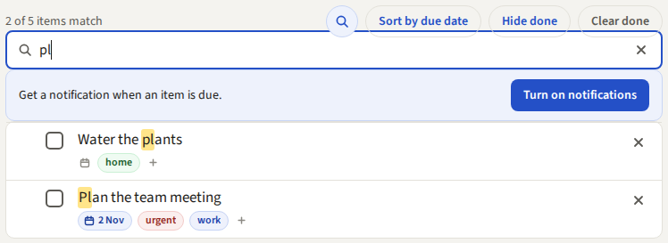

## Order of the items

You put the items in order by hand:

- Drag an item by its grip (⋮⋮) on the left to a new place.
- With the keyboard: press Tab until the grip has the focus, then press the up arrow or the down
  arrow.

An overdue item stays where you put it, and you can move it like any other item. To see the
overdue items at the top, use **Sort by due date**.

### Sort by due date

Click **Sort by due date** above the list. The rows slide to their new places, so you can see
where each item goes. The order is then:

1. The overdue items, the most overdue first.
2. The other items with a due date, the earliest date first. An item that is due all day comes
   after the items with a time on that day.
3. The items without a due date.

Items with the same due date, and the items without a due date, keep your order. Done items keep
their place in this order too.

In this order the grips go away, and you cannot drag items. The rows move to the left, so no
empty space stays. A gray hint under the buttons says "Sorted by due date. To drag items, click
“Sort by hand”". A new item, or an item with a new due date, goes to its place at once.

Click **Sort by hand** to go back. Your order by hand is still there. The app remembers your
choice, also on your other computers.

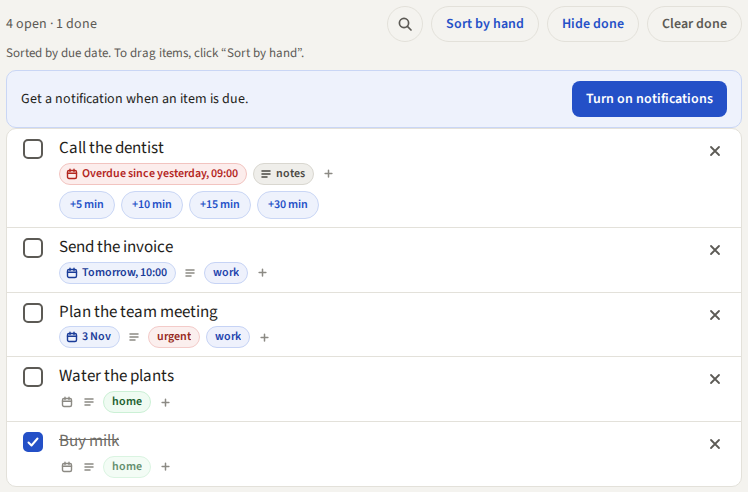

## Due dates

Under its text, an item without a date has a small calendar icon.

1. Click the calendar icon. A pop-up opens.
2. Pick a day.
3. If you want a time, type it in the second field. Type only the digits: `1430` becomes 14:30.
   The app uses the 24-hour clock.
4. Click **Save**.

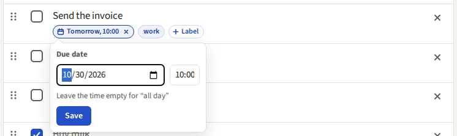

- If you leave the time empty, the item is due all day.
- After Save, the chip shows the date, for example "Tomorrow, 10:00". It is red when the item is
  overdue.
- To change a date, click the chip.
- To remove a date, point at the chip and click the × that shows in it.
- Esc closes the pop-up and does not save.

The app shows the times in the time zone of your browser.

### Repeat an item

An item with a due date can repeat: every day, every week, every month or every year.

1. Click the calendar icon or the date chip of the item.
2. In the pop-up, choose the rule in the list **Repeat**, for example "Every week".
3. Click **Save**. The date chip shows ↻.

When you check off a repeating item, it stays open, and its date moves to the next time. A
gray line under the item says "Done. Next time: …". To put the old date back, click **Undo**
in this line within 8 seconds.

- The next date is always after today. If you check off an item late, the app skips the times
  that you missed. If you check it off early, the next time comes after the date that it had.
- The time of the item stays.
- "Every month" on the 31st uses the last day of a shorter month, for example 28 February, and
  then the 31st again. "Every year" on 29 February uses 28 February in other years.
- To stop the repeat, choose "Never". If you remove the date, the repeat goes too.
- You can also choose the repeat for a new item, in the pop-up of the calendar icon under the
  add field.

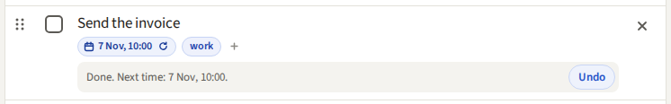

### Overdue items

When the due time passes, the date text becomes red ("Overdue since …"), and the postpone buttons
show. In **Sort by hand** the item stays at its place. In **Sort by due date** it moves to the
top of the list.

## Reminders

The browser can show a notification when an item is due.

1. When you have an item with a due date, the list shows **Turn on notifications**. Click it.
2. The browser asks for permission. Click **Allow**.

The app shows each notification only one time, also if you have more than one tab open. If the
list says "Notifications are blocked in your browser settings", allow notifications for this
site in your browser settings.

### Postpone

An overdue item shows the buttons **+5 min**, **+10 min**, **+15 min** and **+30 min**. Click one
to move the due time to that many minutes from now.

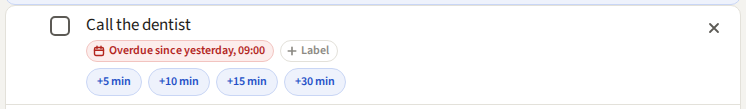

## Labels

Labels such as "work" or "home" put your items into groups. Each label has a color.

### Add and remove labels

1. Click the small **+** under the text of an item. The label list opens.
2. Click a label name to add it to the item. A check shows on its line.
3. Click a name with a check to remove that label from the item.
4. The list stays open, so you can click more names. Press Esc or click outside the list to close
   it.

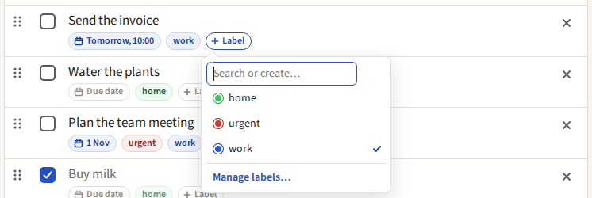

To find a label, type a part of its name in the search field at the top of the list. The last
line, **Manage labels…**, opens the Labels page.

You can also remove a label from an item without the list: point at the label on the item and
click its ×. On a phone the × always shows.

### Create a label for an item

1. In the label list, type the name of the new label.
2. The last label line shows **Create “name”**. Its color circle shows the color that the label
   will get. To pick another color, click the circle first, then use the color wheel (see below).
3. Click **Create “name”**. The app makes the label and adds it to the item.

### The Labels page

Click **Labels** at the top right of your list, or **Manage labels…** in a label list. The
Labels page shows all your labels. Each line has the color circle, the name, the number of items
with the label, and an ×. Click a name to show only the items with that label.

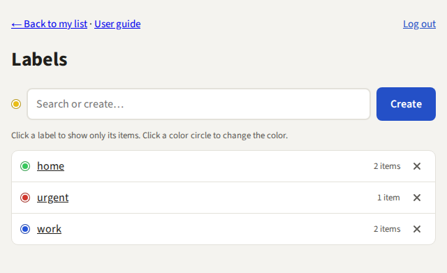

- **Create a label:** type its name in the field "New label" and click **Create**, or press
  Enter. To pick its color first, click the color circle at the start of the field. If you have
  a label with this name already, the page says so.
- **Change a color:** click the color circle of a label. A pop-up with a color wheel opens under
  the circle. Click or drag on the wheel. The angle sets the color, and the distance from the middle sets how
  strong it is. You can also use the arrow keys. Click **Done** to save the color, or **Cancel**
  to keep the old color. Esc or a click outside the pop-up also keeps the old color.
- **Delete a label:** click the × of its line. The page asks "Delete “name”?" and shows how many
  items use the label. Click **Delete**. The app removes the label from all items. The items stay.

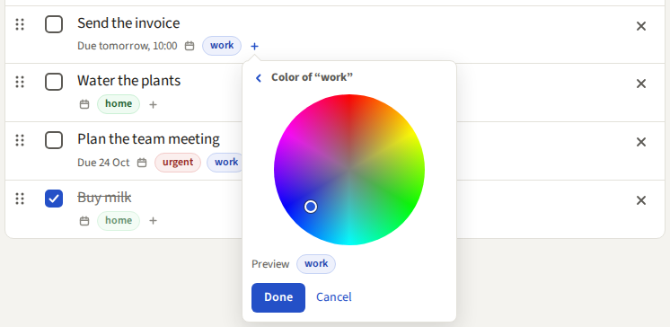

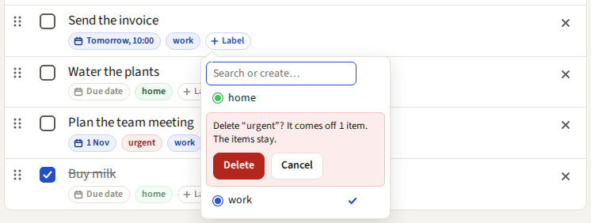

### Show only the items of one label

Click a label on an item. The list shows only the items with that label, and the top of the list
shows "Label: name". Under the add field this label is already selected, so a new item that you
add here gets it. Click its × if the new item must not have this label.

To see all items again, click the × next to "Label: name".

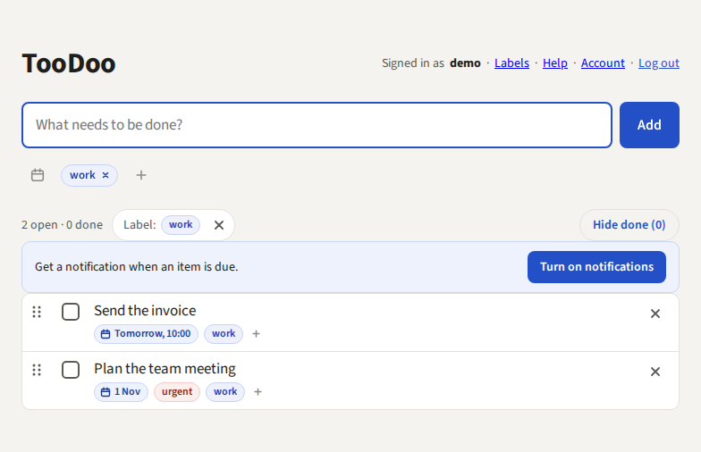

### Limits

- A label name has at most 30 characters and no comma.
- An item has at most 5 labels.
- You can have at most 50 labels.

## On a phone

The app works in the browser of a phone. On a narrow screen:

- The top of the list shows only the links **Labels**, **Help** and **Account**. **Log out** is
  on the Account page.
- In the due date pop-up, the time field is under the date field.

On a touch screen:

- The calendar icon, the notes icon and the + of an item are larger, and the × on a date, a
  label or the **notes** chip always shows.
- The calendar icon and the + under the add field are larger, and the × in the due date button
  always shows.
- In the label list, the due date pop-up and the notes pop-up, the lines, the fields and the
  buttons are larger.
- On the Labels page, the × of a label and the color circles are larger.

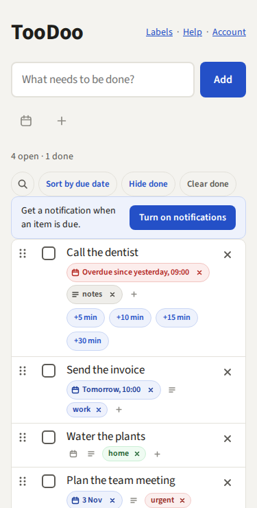

## Android app

There is also an app for Android phones (Android 8.0 and newer). It shows the same list as the
web, so a change on the phone shows in the browser and the other way round.

- **Install:** get the app from Google Play:
  https://play.google.com/store/apps/details?id=com.codeleet.toodoo
- **Log in** with your username and password. You stay logged in while you open the app at
  least every two weeks. Sign-up, the password change and deleting the account are on the web;
  the menu's "Account (web)" opens that page.
- **Privacy policy:** "Privacy policy" on the login screen and in the menu (⋮) opens
  https://toodoo.fly.dev/privacy in the browser.
- **The list:** swipe a row to the right to mark it done (on a done row, the same swipe marks it
  not done again). Swipe a row to the left to delete it. Both show Undo for a few seconds, and
  the change is saved when Undo goes away. Hold a row still for half a second until it lifts,
  then drag it to change the order. For now, you cannot move an overdue row in the app. A
  repeating item that you mark done in the app comes back with its next date; for now, you can
  set the repeat only on the web, and the app has no search. The app does not show the notes of
  an item yet; a change in the app keeps them. Pull
  down to load the list again. The first time, a blue hint above the list explains this; "Got
  it" closes it.
- **Without swiping:** the item sheet has a "Mark as done" button. With TalkBack, each row has
  the actions Mark as done, Move up, Move down and Delete.
- **An item:** tap it. The sheet has the text, the due date, Postpone, the labels, "Mark as
  done", and Delete. Tap "Date" to pick the day. Then tap the time button to pick the time on a 24-hour
  clock. The keyboard icon in the time picker lets you type the time instead. "All day" removes
  the time. Save sends the text and the due date.
- **Labels for a new item:** when you tap the add field, a row of your labels shows between the
  field and the keyboard. The labels with the most items come first; swipe the row to see more.
  Tap a label to select it, and tap it again to clear it. "Add" gives the new item the selected
  labels, then the row clears. With the label filter on, its label is already selected. To
  create a new label, use "All labels" in the item sheet or the label list from the top bar.
- **Labels of an item:** the sheet shows a row of all your labels. The labels of the item come
  first and are selected; the others follow, most used first. Tap a label to put it on the item
  or take it off, at once (no Save). The order stays while the sheet is open.
- **Labels:** "All labels" in the sheet and the tag button at the top open the same list,
  "Labels". Type in the field "Search or create…" to find a label. If no label has that name,
  "Create" makes it. From the top bar you can create a label before any item has it. Tap a color
  dot for the color wheel. The × deletes a label.
- **Show only the items of one label:** open "Labels" with the tag button at the top. The text
  under the field says "Tap a label to show only its items." Tap a label to do that. From "All
  labels" in the sheet, a tap on a label adds it to the item or removes it.
- **Reminders:** the phone reminds you when an item is due, also when the app is closed. The
  reminder has the buttons Done and Postpone 10 min. The app asks for permission to notify when
  you set your first due date. Without a connection the app shows the last list it loaded; changes
  need the connection.

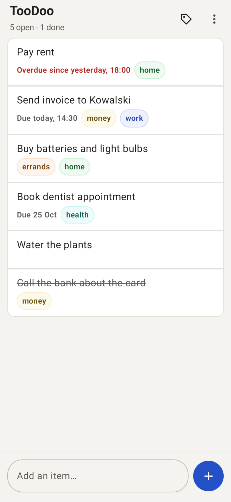

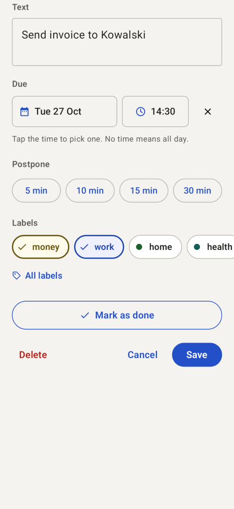

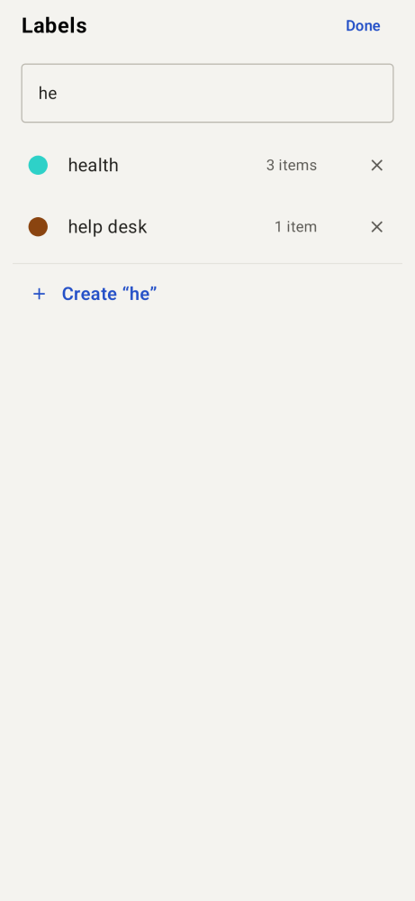

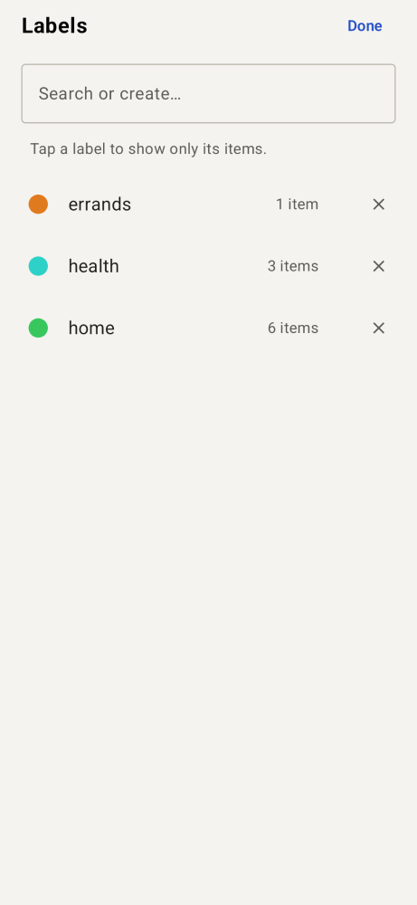

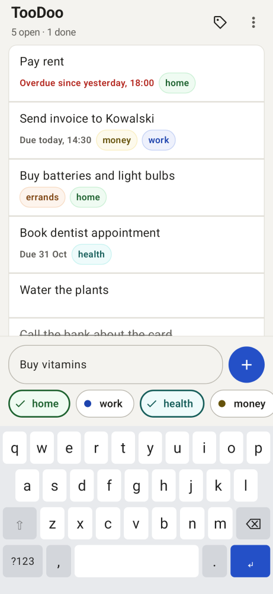

## Keys

| Where | Key | What it does |
| --- | --- | --- |
| Anywhere in the list | A letter or a digit | Starts a new item in the add field |
| Add field | Enter | Adds the item |
| Item in edit mode | Enter | Saves the text |
| Item in edit mode | Esc | Cancels the change |
| Anywhere in the list | / | Opens the search |
| Search field | Esc | Closes the search and shows all items |
| Grip (⋮⋮) | Up arrow, down arrow | Moves the item |
| List, after a delete | Ctrl+Z | Brings the deleted item back (while **Undo** shows) |
| List, after the notes are removed | Ctrl+Z | Brings the notes back (while **Undo** shows) |
| Due date pop-up | Enter | Saves the date |
| Due date pop-up | Esc | Closes the pop-up |
| Notes pop-up, field | Enter | Makes a new line |
| Notes pop-up, field | Ctrl+Enter (⌘+Enter on a Mac) | Saves the notes |
| Notes pop-up | Esc | Closes the pop-up without saving |
| Label list, search field | Down arrow | Goes to the first label name |
| Label list | Up arrow, down arrow | Moves between the label names |
| Label list, search field | Enter | Adds or removes the first label, or creates the typed label |
| Label list | Esc | Closes the list |
| Color wheel | Arrow keys | Changes the color |
| Color wheel | Enter | Done |
| Color wheel | Esc | Cancel |
